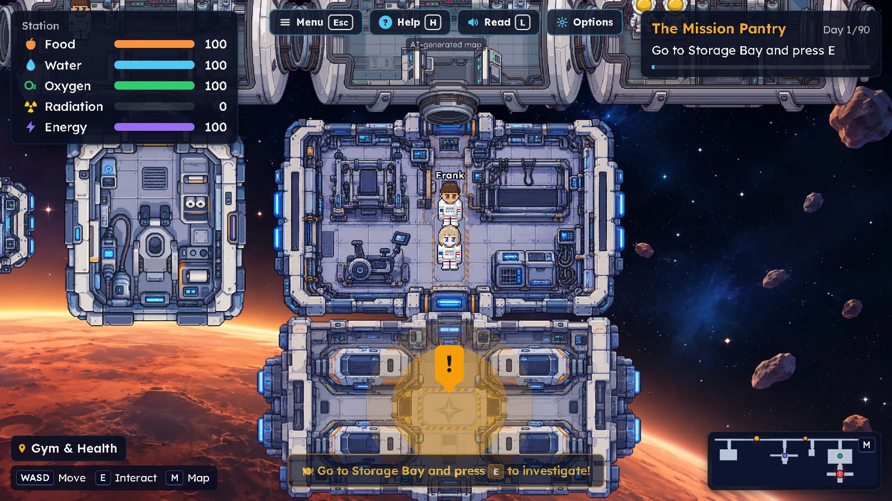
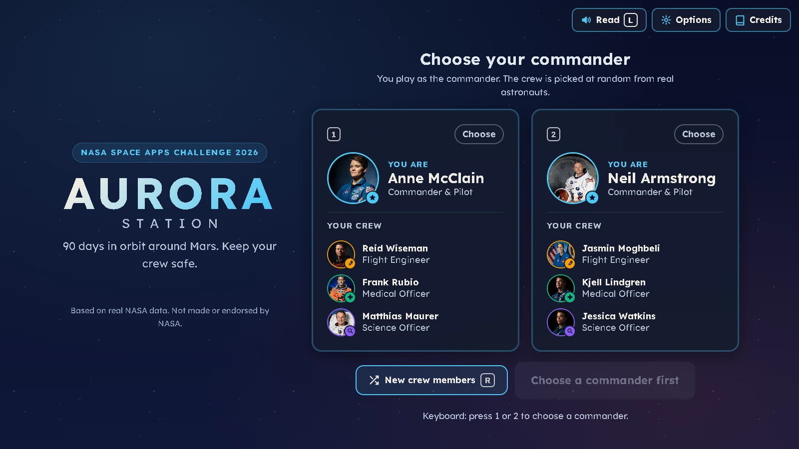
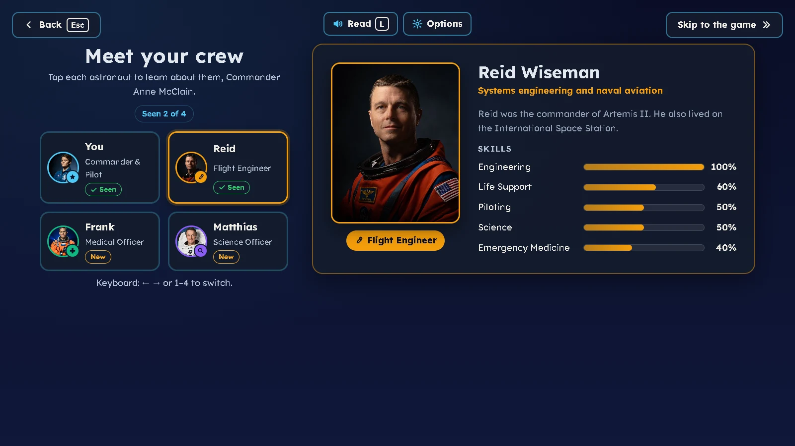
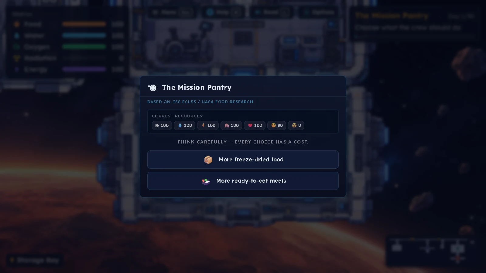
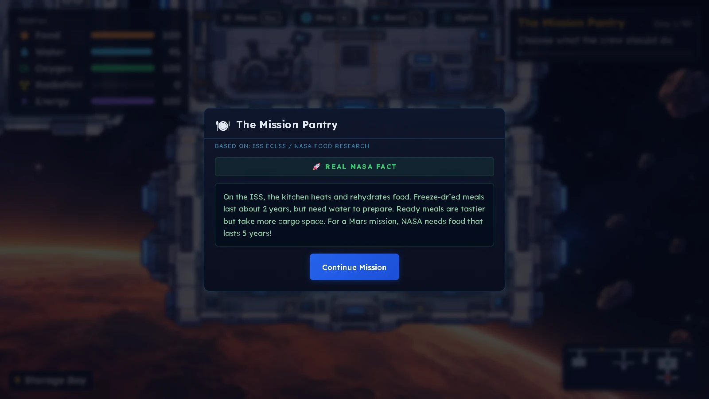
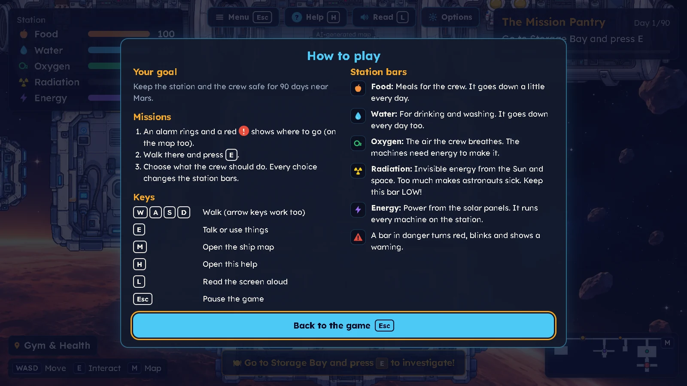
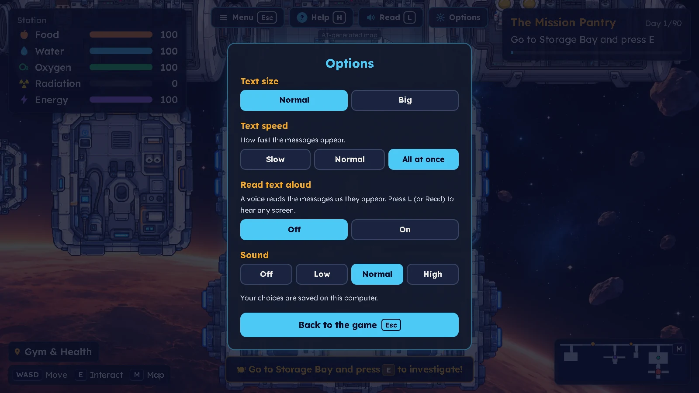
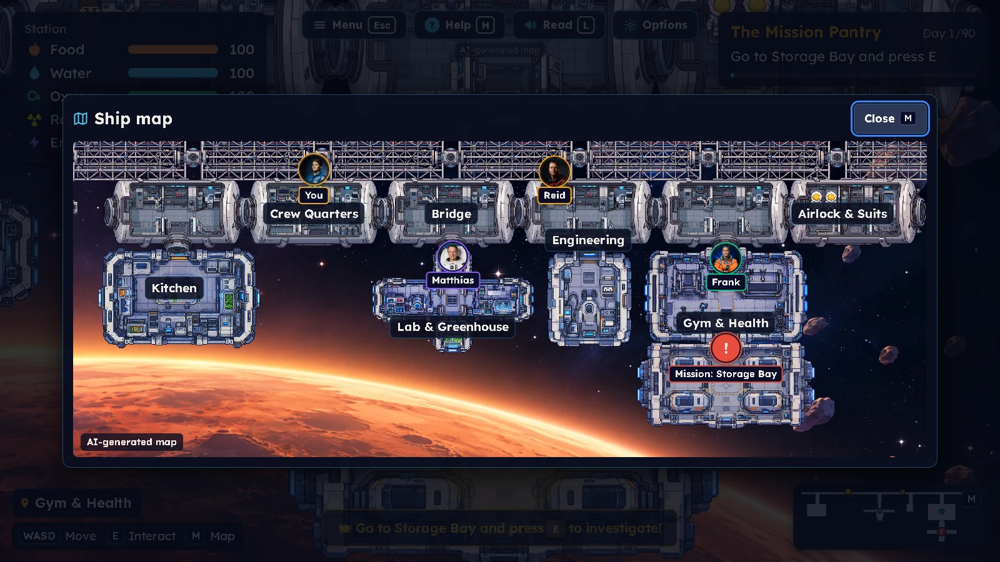
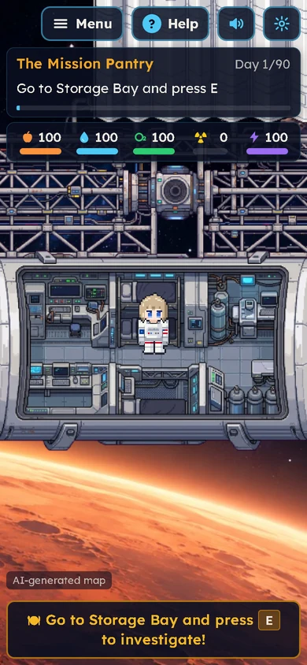

# Aurora Station

**A space station game for kids aged 7 to 12, built for the NASA Space Apps Challenge 2026.**

You are the commander of a space station orbiting Mars for 45 days. Walk through the station, meet a crew of real astronauts, and decide what to do when something goes wrong: a broken CO₂ filter, a fire, an air leak, a solar storm. Every choice changes the station's food, water, oxygen, radiation and energy, and every mission ends with a real NASA fact.

<!-- TODO(team): add the live demo link (Vercel) here, e.g. **[▶ Play it in your browser](https://...)** -->



## How a day works

1. **An alarm rings.** A red **!** appears in a room and on both maps, and the mission panel says where to go.
2. **Walk there and press E.** The mission window explains the problem in simple words.
3. **Choose what the crew should do.** Each choice has a cost: there is no perfect answer.
4. **See what happened** and learn a **real NASA fact** behind the story.
5. **Review the day** and start the next one. The mission lasts 45 days in three acts: *All Systems Go*, *Things Get Complicated* and *Survive*.

| Choose your commander | Meet your crew |
|---|---|
|  |  |
| **A mission choice** | **A real NASA fact** |
|  |  |

## The station meters

All five meters belong to the whole station, not to one person.

| Meter | What it means | Goal |
|---|---|---|
| Food | Meals for the crew. Goes down every day. | Keep it high |
| Water | For drinking and washing. Goes down every day. | Keep it high |
| Oxygen | The air the crew breathes. The machines need energy to make it. | Keep it high |
| Radiation | Invisible energy from the Sun and space. Too much makes astronauts sick. | **Keep it low** |
| Energy | Power from the solar panels. Runs every machine. | Keep it high |

When a meter is in danger it turns red, blinks **and** shows a written warning ("Food is low!"), so color is never the only signal.

## Real NASA science inside

**Missions.** The game has 83 missions: 61 problems the station runs into during the trip, and 22 follow-ups that only happen because of an earlier choice (a quick fix that breaks again, a sick crew member, a leak that gets worse). Each one is based on a real event or study. Some examples:

| Mission | Based on |
|---|---|
| The Mission Pantry | NASA space food research |
| The Broken Filter | Apollo 13 (1970) |
| Fire on the Station! | Mir space station (1997) |
| Crash! | Mir space station, Spektr module (1997) |
| The Invisible Leak | ISS air leak (2004) |
| Toxic Air! | ISS Elektron oxygen generator (2006) |
| Mars' Shadow Is Coming | ESA Mars Express eclipse season (2006) |
| The Bathroom Broke | ISS toilet and Water Recovery System (2008) |
| Water in the Helmet! | ISS spacewalk EVA-23 (2013) |
| The First Harvest | NASA Veggie, plants grown on the ISS (2015) |
| Debris Storm! | ISS debris alert (2021) |
| Total Silence | NASA CHAPEA Mars simulation (2024) |
| A Storm Left the Sun! | NASA DONKI space weather data |

**Live space weather.** The game reads real solar storms (CMEs) and geomagnetic storms from **NASA DONKI** through [api.nasa.gov](https://api.nasa.gov). The Credits screen shows which storms were heading to Mars. If NASA can't be reached, the game uses saved data and labels it **NOT LIVE**.

**Real astronauts.** Each new game draws two possible crews from real astronauts, using their official NASA portraits (public domain). The events in the game are made up.

## Made for every kid

Accessibility was part of the design from the start, following the team's UX guide and Nielsen's heuristics. We checked every screen with [axe-core](https://github.com/dequelabs/axe-core) (WCAG 2.2 AA): no issues found.

- **Read aloud:** press **L** (or the *Read* button) on any screen to hear it. In the mission window this includes the choices. *Options → Read text aloud* reads every message as it appears.
- **Options** on every screen: big text, text speed (slow, normal, all at once) and sound level.
- **Help (H)** explains the goal, the missions, each meter and every key.
- **Lexend**, a font designed to make reading easier, with text of 18 px or more.
- **Full keyboard play** (WASD or arrow keys, E, M, H, L, Esc), large buttons (44 px or more) and visible focus.
- **Pause anytime** (Esc), and a question before leaving or starting over.
- **Works on any screen size**, from wide monitors to tablets and phones.

| Help (H) | Options | Ship map (M) | Phone |
|---|---|---|---|
|  |  |  |  |

## Run it locally

You need [Node.js](https://nodejs.org) 20.19+ or 22.12+.

```bash
npm install
npm run dev        # http://localhost:5173
```

**NASA API key (recommended).** Without a key the game uses NASA's shared `DEMO_KEY`, which allows only a few requests per hour, so the space weather often shows NOT LIVE. Get a free key at [api.nasa.gov](https://api.nasa.gov) and create a `.env.local` file in the project root:

```bash
VITE_NASA_API_KEY=your_key_here
```

On Vercel, add the same variable under *Settings → Environment Variables* and redeploy.

Other commands:

```bash
npm run build      # type-check and build to dist/
npm run preview    # serve the build
npm run lint       # oxlint
```

## How it's built

| Part | Tool |
|---|---|
| Station world, movement, camera | [Phaser 3](https://phaser.io) |
| Menus, HUD, missions, dialogue | [React 19](https://react.dev) + TypeScript (strict) |
| Shared game state (saved in the browser) | [Zustand](https://zustand.docs.pmnd.rs) |
| Build and styles | [Vite](https://vite.dev), [Tailwind CSS 4](https://tailwindcss.com) |
| Read aloud | Browser Web Speech API (no server, no audio files) |
| Music and sound | Procedural Web Audio synthesis plus the project's original legacy alert MP3 |

Phaser draws the station; React draws everything on top of it. They talk through a small event bus, and Zustand keeps the data both sides need.

```
src/
  game/         Phaser: scenes, station layout, player and crew
  components/   React: screens, HUD, mission window, menus
  stores/       Zustand stores (resources, missions, crew, settings)
  data/         Missions, astronauts, crews
  services/     NASA DONKI client
docs/           Game design, architecture, art direction, screenshots
```

More detail in [docs/GAME_DESIGN.md](docs/GAME_DESIGN.md), [docs/TECHNICAL_ARCHITECTURE.md](docs/TECHNICAL_ARCHITECTURE.md) and [docs/ART_DIRECTION.md](docs/ART_DIRECTION.md).

## Use of AI

We follow the Space Apps rules on AI and declare it here and in the game's Credits screen.

- **All the creative work is ours:** the idea, the game rules, the story, the missions and the design documents. No AI wrote them.
- **Code:** an AI assistant (Claude, by Anthropic) helped us write the code.
- **Station map:** made with an AI image tool (ChatGPT, by OpenAI). We started from a floor plan of the International Space Station and guided the tool step by step. In the game it always shows an **"AI-generated map"** mark.
- **Characters:** our team drew the astronauts by hand in Aseprite. We also tried ChatGPT to clean up the character art.

<!-- TODO(team): confirm the origin of the Mars backdrop (public/assets/environments/mars-backdrop.jpg). If it was AI-generated, add it to the list above and to the Credits screen. -->

## Credits

- **Data:** NASA DONKI (Space Weather Database) via api.nasa.gov.
- **Astronaut photos:** official NASA portraits, public domain, via Wikimedia Commons. The full list is in the game's Credits screen.
- **Font:** [Lexend](https://fonts.google.com/specimen/Lexend) (SIL Open Font License).
- **Audio:** procedural synthesis released under [CC0 1.0](https://creativecommons.org/publicdomain/zero/1.0/), except for the restored legacy alert MP3, whose external origin is unknown. Full list: [docs/AUDIO_SOURCES.md](docs/AUDIO_SOURCES.md).

## Team

Made by our team for the **NASA Space Apps Challenge 2026**:

| Name | GitHub |
|---|---|
| Enzo Gentil Xavier Barroso | [@Gentil-sudo](https://github.com/Gentil-sudo) |
| Gabriela Campelo Costa | [@gabiscamp](https://github.com/gabiscamp) |
| Pamela Fernandes Nilo | [@pamelanilo](https://github.com/pamelanilo) |
| Rafael Gomes Antunes de Oliveira | [@rafaelgantunes](https://github.com/rafaelgantunes) |

<!-- TODO(team): add a license. -->

*This is a student project. It is not made or endorsed by NASA. The crews use the names of real astronauts to honor their work; the astronauts are not involved with this project.*
